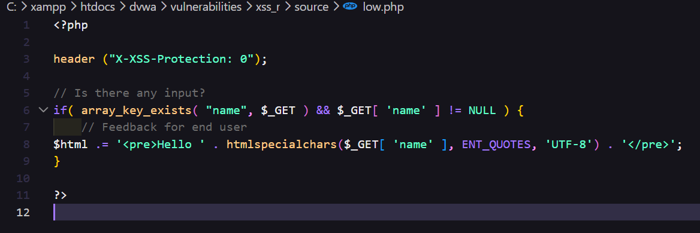
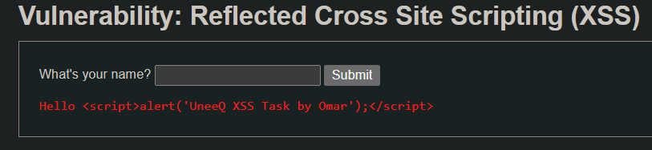

# Web App Security: Reflected Cross-Site Scripting (XSS) Assessment & Remediation

**Author:** Omar Ahmed  
**Task:** Vulnerability Assessment & Patching (Reflected XSS)  
**Platform:** DVWA (Damn Vulnerable Web App) - Security Level: Low  

## 1. Introduction
This report documents the discovery, exploitation, and remediation of a Reflected Cross-Site Scripting (XSS) vulnerability within the DVWA environment. 

## 2. Baseline Validation
To establish the expected application behavior, a standard string input (`Omar`) was submitted. The application successfully reflected the input without any errors.


## 3. Vulnerability Exploitation
To test for XSS, the following JavaScript payload was injected into the input field:
`<script>alert('UneeQ XSS Task by Omar');</script>`

The application executed the script, triggering a browser pop-up. This confirmed the presence of a Reflected XSS vulnerability due to a lack of input sanitization.


## 4. Remediation (Code Fix)
The source code (`low.php`) was modified to prevent the execution of injected scripts. The PHP function `htmlspecialchars()` was implemented to convert special characters (such as `<` and `>`) into HTML entities, effectively neutralizing the payload.

**Vulnerable Code:**
```php
$html .= '<pre>Hello ' . $_GET[ 'name' ] . '</pre>';
```

**Secured Code:**
```php
$html .= '<pre>Hello ' . htmlspecialchars($_GET[ 'name' ], ENT_QUOTES, 'UTF-8') . '</pre>';
```



## 5. Verification
The exact same payload (`<script>alert('UneeQ XSS Task by Omar');</script>`) was submitted again after applying the patch. The application safely rendered the payload as plain text rather than executing it, confirming that the vulnerability has been successfully remediated.



---
*Note: The complete modified source code can be found in the attached `low.php` file in this repository.*
## 📊 Risk Matrix

The following matrix evaluates the identified security weaknesses within the target application (`DVWA - XSS Reflected` module) based on exploitability and potential business/user impact:

| ID | Finding | Affected Component | Likelihood | Impact | Overall Risk | Status |
| :--- | :--- | :--- | :--- | :--- | :--- | :--- |
| **VULN-01** | Reflected Cross-Site Scripting (XSS) | `GET /vulnerabilities/xss_r/?name=` (`low.php`) | High | High (Session hijacking, phishing, unauthorized actions) | **High** | Remediated |
| **VULN-02** | Missing Content Security Policy (CSP) & Hardening Headers | HTTP Response Headers | Medium | Medium (Unrestricted execution of inline scripts) | **Medium** | Recommended |

### Risk Rating Criteria
* **High:** Easily exploitable vulnerability that allows an attacker to execute arbitrary JavaScript in a victim's browser session, potentially leading to account takeover.
* **Medium:** Defense-in-depth weakness that increases the severity or likelihood of client-side attacks if an injection flaw exists.
* **Low:** Minor informational exposure or best-practice deviation with minimal direct security impact.

---

## ✅ Remediation Checklist

Use the following checklist to ensure complete protection against Cross-Site Scripting (XSS) vulnerabilities across the application:

- [x] **Context-Aware Output Encoding:** Applied `htmlspecialchars($_GET['name'], ENT_QUOTES, 'UTF-8')` in `low.php` to safely convert special HTML characters (`<`, `>`, `"`, `'`, `&`) into harmless HTML entities before rendering.
- [x] **Patch Verification:** Re-tested the input field with the proof-of-concept payload (`<script>alert('UneeQ XSS Task by Omar');</script>`) and confirmed it renders strictly as plain text without script execution.
- [ ] **Server-Side Input Validation:** Implement strict allow-list validation (e.g., permitting only alphabetic characters and spaces for name fields) before processing user input.
- [ ] **Content Security Policy (CSP):** Configure a restrictive `Content-Security-Policy` header (e.g., `Content-Security-Policy: default-src 'self'; script-src 'self'`) to block unauthorized inline scripts.
- [ ] **Secure Cookie Attributes:** Enforce `HttpOnly`, `Secure`, and `SameSite=Strict` flags on sensitive cookies (such as `PHPSESSID`) to prevent JavaScript access via `document.cookie`.
- [ ] **MIME-Sniffing Protection:** Add the `X-Content-Type-Options: nosniff` HTTP response header to prevent browsers from interpreting files as a different MIME type.
